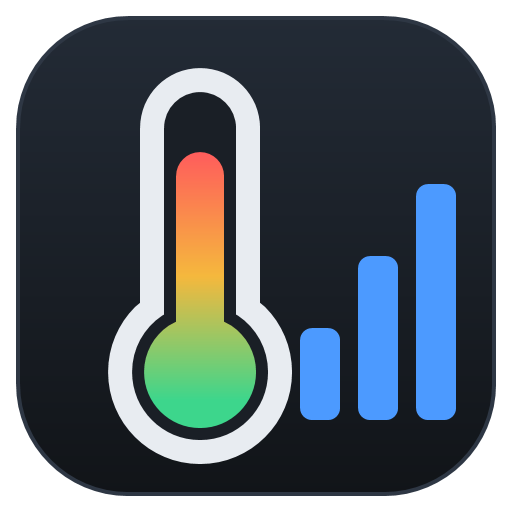

# Temp Monitor

A Windows desktop app that shows live temperature and usage for the CPU, GPU, RAM and SSD, refreshed every second.

## Run it (portable)

The app is one file, `dist\TempMonitor.exe`, about 73 MB. It includes .NET and every library it needs, and it writes no settings anywhere. Copy it to a pendrive and run it on any 64-bit Windows 10 or 11 PC.

1. Double-click `TempMonitor.exe` and accept the administrator prompt. The CPU, RAM and drive sensors need admin rights.
2. **First time on a PC:** if the banner says PawnIO isn't installed, click **Install PawnIO**. It installs the driver with winget, or opens [pawnio.eu](https://pawnio.eu/) if winget isn't available. Then reopen the app. Without PawnIO, CPU (and RAM) temperatures show N/A; everything else works.
3. Optional: tick **Start with Windows**. This creates a Task Scheduler task ("TempMonitor") that starts the app minimized when you sign in. The task runs with admin rights, so there's no UAC prompt, and it also starts on battery power. Untick the box to remove it. The task points at wherever the exe was when you ticked it, so copy the exe onto the PC's own drive first rather than running it from the pendrive.

**Tray icon:** the notification-area icon shows the live CPU temperature as a number, green, amber or red by the same thresholds as the CPU card (it follows the °F setting). Hover for CPU and GPU temperature and usage. Double-click opens the window; right-click gives **Show** and **Exit**. Minimizing the window sends it to the tray, and the sign-in copy starts in the tray. Closing the window exits the app.

**Run as admin:** this button appears in the top bar whenever the app is running without admin rights. It restarts the app with the admin prompt; if you decline the prompt, the current copy keeps running.

Only one copy of the app runs at a time. Opening it again brings the existing window to the front.

On a new PC, Windows SmartScreen may warn that the app is from an unknown publisher, because the exe isn't code-signed. Click **More info → Run anyway**.

**Save diagnostics** writes `diagnostics.txt` next to the exe.

## Where the numbers come from

| | Temperature | Usage |
|---|---|---|
| CPU | Package sensor (Intel DTS via MSR, needs PawnIO); `Tctl/Tdie` on AMD | Total load across all threads (same as Task Manager) |
| GPU | GPU core sensor from the vendor driver (AMD ADL / NVIDIA NVAPI); hot spot shown below | Busiest engine (3D, compute, copy, video): the same definition Task Manager uses. VRAM is shown on a second bar |
| RAM | DIMM thermal sensor over SMBus, if the modules have one (needs PawnIO) | Physical memory in use |
| SSD/HDD | SMART / NVMe health log, with Windows' storage reliability counter as a fallback. USB drives: SMART attribute 194 read through the enclosure (ATA pass-through) | Active time (100 − idle time, as in Task Manager); space used is shown on a second bar |

USB drives appear and disappear as you plug them in. So that an idle external hard disk can still spin down, its temperature is polled only while the drive has been active in the last 5 minutes. After that, the card shows the last reading and how old it is.

The source is labeled under each temperature. **All sensors** shows every raw value the library can see, so you can cross-check against HWiNFO or Task Manager.

When a device has no sensor, the app shows **N/A** with the reason. It never shows an estimated value. Many laptop RAM modules, including soldered DDR4, have no thermal sensor. Some SSDs behind Apple's T2 controller don't report SMART temperature.

## Build from source

Requires the .NET 8 SDK. Open `TempMonitor.sln`, or from a terminal:

| Project | What it is |
|---|---|
| `src/TempMonitor.Core` | Platform-neutral model: `Reading`, temperature levels, `CardHistory` (graph data), `ISensorProvider` |
| `src/TempMonitor.Sensors.Windows` | Windows sensors (LibreHardwareMonitor, storage APIs, SMART over USB), PawnIO install, start at sign-in, run as admin |
| `src/TempMonitor.Avalonia` | **The app (2.0)**: cross-platform UI (Avalonia 11.3), same features as 1.x; Linux build coming |
| `src/TempMonitor` | The original WPF app (1.x), kept as a reference until 2.0 replaces it |
| `tests/TempMonitor.Core.Tests` | Unit tests (`dotnet test`) |

Portable single exe (2.0, Avalonia):

```
dotnet publish src\TempMonitor.Avalonia -c Release -o dist
```

The 1.x WPF exe: `dotnet publish src\TempMonitor -c Release -o dist`.

The logo and icon are generated by `tools/IconGen` (vector drawing, rendered at 16–256 px). To regenerate them:

```
cd tools\IconGen
dotnet run -- ..\..\src\TempMonitor\Assets
```

For development without a UAC prompt, build a non-elevated copy. Admin-only sensors will show N/A:

```
dotnet build src\TempMonitor.Avalonia -p:AsInvoker=true -o build\dev
```

Sensors are read with [LibreHardwareMonitorLib](https://github.com/LibreHardwareMonitor/LibreHardwareMonitor) 0.9.6 (MPL-2.0).
